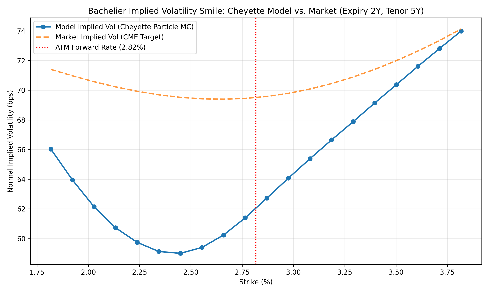

# Swaption Volatility Smile Calibration: Cheyette Model & Particle Method

## Overview
This repository contains the Python implementation developed for my **MSc Thesis in Quantitative Finance** at the *Università degli Studi di Verona*. 

It implements a non-parametric calibration of the **Cheyette Local Volatility Interest Rate Model** to real market swaption smiles (**CME Group** quotes and **€STR** yield curve) using the **McKean-Vlasov Particle Method** and **Dupire's local volatility framework** under a Normal (**Bachelier**) pricing measure.

---

## Mathematical & Numerical Architecture

1. **Yield Curve Bootstrapping (`YieldCurve`):** 
   Parses €STR zero-rate quotes across 27 maturities (1W to 15Y), computing discount factors $P(0,t)$ via log-linear interpolation and instantaneous forward rates $f(0,t)$ via central finite differences.
2. **Arbitrage-Safe Surface Pre-Processing (`RealVolSurface` & `MarketPreprocessor`):**
   * Interpolates CME 5Y-tenor swaption smiles across expiries (1M to 2Y) using **Natural Cubic Splines** to guarantee continuous second-order strike derivatives ($\partial^2 C / \partial K^2$) required by Dupire's denominator.
   * Implements **flat tail extrapolation** outside observed strike boundaries ($\pm 200\text{ bps}$ around ATM) to prevent polynomial divergence during Monte Carlo simulation.
3. **Cheyette Particle Calibrator (`CheyetteParticleCalibrator`):**
   * Simulates $N = 5,000$ interacting particles for the state variables $(X_t, Y_t)$ under a monthly Euler-Maruyama discretization ($\Delta t = 1/12$), enforcing a non-negativity floor on the auxiliary variance process $Y_t$.
   * At each time step, calibrates the local volatility function $\sigma_{\text{loc}}(t, S_t)$ via clamped cubic splines by matching conditional expectations of the drift correction term against Bachelier-Dupire market densities.
4. **Smile Inversion & Validation:** 
   Prices European swaptions (2Y into 5Y) via Monte Carlo payoffs and inverts the Bachelier formula using **Brent's root-finding method (`scipy.optimize.brentq`)** to compare model-implied vs. market-implied normal volatilities (in bps).

---

## Key Results: 2Y5Y Swaption Volatility Smile Fit



---

## Technologies & Libraries
* **Python 3.x**
* `NumPy` (Vectorized particle evolution & array operations)
* `SciPy` (`CubicSpline`, `interp1d`, `norm`, `brentq`)
* `Matplotlib` (Smile visualization)

## How to Run
```bash
pip install -r requirements.txt
python cheyette_calibration.py
